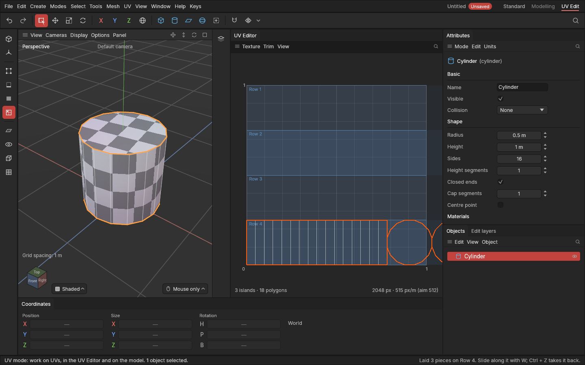

# Trim sheets

> Make the rows of a shared trim texture, then lay strips of your model straight along them.

## When to use it

A **trim sheet** is a texture made of horizontal rows, each a detail that repeats left to right: a row of bolts, a worn panel edge, a rubber seal, a strip of hazard stripes. Game artists texture much of a model with one. Instead of giving every strip its own pixels, they lay it along a row of the shared texture. Many props then share one texture and stay sharp however big they are, because the rows repeat.

Use it for long, thin parts:

- the strips a bevel makes;
- a cylinder's or pipe's side;
- the border of a panel;
- the rim of a hatch.

Big unique surfaces still get their own texture, [unwrapped](unwrapping.md) and [packed](packing.md) as usual.

## How to use it

1. **Make the rows.** In the UV Editor, open the **Trim** menu (also **UV → Trim sheet**).
   - **Even rows: 2, 4, 8, 16** splits the texture into rows of the same height.
   - Each row has a **Name** ("Bolts"), where it starts **From top** and its **Height**, in the texture's pixels (as an image editor shows them).
   - **Add a row** puts a new one under the lowest. **×** removes a row; **Remove every row** clears them.

   The rows show as faint bands across the UV Editor's square, with their names. They repeat past its right side. The rows are saved with the project, and each change is one undo step.
2. **Choose what to lay.** Select the strip: in the UV mode, click its piece (in the UV Editor or on the model). Or select polygons in it. With nothing selected inside an object, all of it is laid.
3. **Lay it.** Choose **UV → Lay out → Put on trim row**, then the row. Each piece:
   - comes out as a straight grid if it's a strip of square-cornered quads (others keep the shape they had);
   - lies the right way round, its long side along the row;
   - is scaled so its height fills the row exactly;
   - starts at the row's left end. Several pieces go one after another.
4. **Slide it along the row** to pick the part of the trim you want: in the UV Editor press **W** and drag the **red arrow**, which moves it only sideways, so it stays on the row. **Flip left to right** (E over the UV Editor) turns a trim's pattern the other way.

It's one undo step, saved with the project and recorded on the object's [edit list](edit-list.md), so it's made again if you change the shape before it.

**Give trim strips a material of their own.** A material is one texture set in Substance Painter and one surface in a game engine. With trim strips on their own material, the trim texture goes only on them ([Materials](materials.md)). [Check for baking](bake-check.md) reminds you when trim pieces share a material with pieces that aren't on the trim sheet.

**Pack and the bake check leave trim pieces alone.** A piece whose top and bottom lie on a row's edges counts as on the trim sheet. Pack doesn't move it. The bake check doesn't count it as outside the square, lying over others, too close or uneven, since trim pieces repeat and overlap on purpose.

## Painting a trim sheet

You can paint the trim sheet right on your model, in [Paint mode](painting-textures.md):

- **Paint any strip.** Paint lands on the texture where that part of the strip repeats from, even where the strip runs past the square. The UV Editor shows the texture as you paint.
- **Every piece updates.** Pieces that use the same material share its texture, so painting one kit piece paints them all: lay every piece's trim strips on the same rows, give them the same material, and paint whichever is easiest to reach.
- **Strokes stay in their row.** A stroke stays inside the trim row it starts in, so a broad stroke along a strip never spills onto the trims above and below. To paint across rows (a background colour for the whole sheet, say), untick **Trim row: Stay in the row** under the brush in **Attributes**.

## Settings

| Setting | What it does |
|---|---|
| **Name** | What the row holds, for the menus. |
| **From top** | Where the row starts, in pixels from the top of the texture. |
| **Height** | How tall the row is, in pixels. Rows can't overlap: a change that would make them is left out. |
| **Trim row: Stay in the row** (Attributes, under the brush, in Paint mode) | On (the standard): a stroke stays inside the trim row it starts in. Off: strokes reach every row. Shown while there are trim rows. |

The pixels are the project's texture size (**Texture** menu). Rows are kept as parts of the texture's height, so a new texture size keeps them in place.

## Shortcuts

| Action | Shortcut |
|---|---|
| Put on trim row | **UV → Lay out → Put on trim row** |
| Slide along the row | **W** in the UV Editor, then drag the red arrow |
| Undo | **Ctrl + Z** |

No keys of their own; ask if you'd like some.

## Tips and common problems

- **Problem:** Put on trim row says there are no rows. **Why:** the trim sheet has none yet. **Fix:** make them in the UV Editor's **Trim** menu.
- **Problem:** after changing a row's height, strips already on it don't follow. **Why:** each strip remembers the band it was laid on, so changing the trim sheet never moves your work by surprise. **Fix:** select them and Put on trim row again.
- **Problem:** a piece came out small and squarish on the row. **Why:** it's about as wide as it is tall (a cap, a square panel), so filling the row's height leaves it short. **Fix:** trim sheets suit long, thin strips. Give squarish pieces their own texture ([Unwrap](unwrapping.md) and Pack) instead.
- **Problem:** Pack moved my trim strip. **Why:** it was moved off the row's edges (dragged up or down), so it no longer counts as on the trim sheet. **Fix:** Put on trim row again, and slide only with the red arrow.
- **Tip:** a bevel strip on a hard edge is the classic trim: bevel, select the strip's piece, put it on a "Panel edge" row.

## Related

- [Unwrap, Relax and Straighten](unwrapping.md)
- [Editing UVs by hand](editing-uvs.md)
- [Packing](packing.md)
- [Check for baking](bake-check.md)
- [Materials](materials.md)
- [Concepts: trim sheet](concepts.md#uvs-and-texturing)
