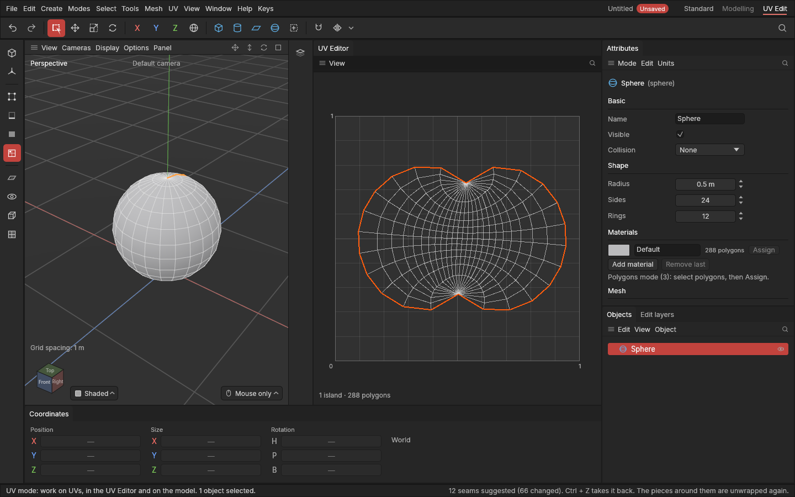

# Unwrap, Relax and Straighten

> Lay the shape's pieces flat along their seams, live as you place seams, and even them out or straighten them afterwards.

## When to use it

**Unwrapping** is flattening the surface along its [seams](seams.md), like unfolding a cardboard box, so a texture can be painted on it. The app does it the way most UV tools do (least squares conformal maps): every little triangle keeps its shape as well as it can, so a checker texture's squares stay square, at the cost of some change in size across very curved pieces.

- **Unwrap** after you change the shape (extrude, bevel, cut) and the UVs look squashed, or to lay a piece out fresh.
- You often don't need to: **marking seams unwraps the pieces around them at once** (the switch **UV → Unwrap as seams change**, on as standard).
- **Relax** evens out UVs you've pulled about by hand, or a piece that stretches.
- **Straighten** lays a piece made of quads out as a perfectly straight grid: the cleanest result for strips and panels in hard-surface work.

## How to use it

1. Select an object. To work on part of it, pick the UV mode or press **1**, **2** or **3** and select the pieces (or polygons, edges or points in them). With nothing selected inside it, the whole object is used.
2. Press **E** with the mouse over the UV Editor (or in the UV mode) and choose **Unwrap**, **Relax** or **Straighten**. They're in the **UV** menu too.
3. Each is one undo step (**Ctrl + Z**), saved with the project and recorded on the object's [edit list](edit-list.md).

What **Unwrap** does with each piece holding the selection:
- lays it flat along its seams. A piece that can't lie flat in one go (a tube, or a closed ball with no seam) is first cut open in a hidden place, and the cut is marked as a seam;
- a piece of **square-cornered quads** (a cylinder's side, a bevel's strip, a flat panel) comes out as a **straight grid**, when **Straighten strips when unwrapping** is on;
- turns it so its sides line up with the square, keeping the way it lay before (a quarter turn at a time);
- sizes it to match the rest of the object, so every piece keeps its **real size** against the others (the same [texel density](concepts.md#uvs-and-texturing));
- puts it where it was. Pieces may overlap until packing arrives.

**Relax** moves only the corners of the selected polygons: each side is pulled towards its real length, so bunched or stretched UVs even out. The other corners stay where they are, so you can relax one area of a piece.

**Straighten** works on pieces made only of quads; others are left as they were (the status bar says so).

## Settings

In the **UV** menu:

| Setting | What it does |
|---|---|
| **Unwrap as seams change** | On (standard): marking or clearing seams unwraps the pieces on either side at once, in the same undo step. Off: only the seams change until you choose Unwrap. |
| **Straighten strips when unwrapping** | On (standard): pieces of square-cornered quads unwrap as straight grids. Off: they're unwrapped like any other piece (a little curved, if the shape is). |

Both are remembered between sessions.

## Shortcuts

| Action | Shortcut |
|---|---|
| Unwrap, Relax, Straighten | **E** over the UV Editor (or in the UV mode), or the UV menu |
| Select pieces | UV mode, then click (or **1**, **2**, **3** for parts) |
| Undo | **Ctrl + Z** |

No keys of their own; ask if you'd like some.

## Tips and common problems

- **Problem:** after unwrapping, pieces overlap. **Why:** each piece is put back where it was, and a fresh piece can be bigger. **Fix:** move them apart with **W** in the UV Editor for now; packing arrives in a later update.
- **Problem:** a ball or rounded piece looks bigger in the middle than at the edges. **Why:** a curved surface can't lie flat without some change in size; unwrapping keeps the shapes and lets the size vary. **Fix:** add a seam or two to split it (Suggest seams helps), then Unwrap.
- **Problem:** a strip came out curved. **Why:** some of its corners aren't square (more than 25° off), or it has a triangle, so it isn't treated as a strip. **Fix:** choose Straighten, or fix the polygons.
- **Problem:** Unwrap marked a seam I didn't place. **Why:** the piece couldn't lie flat in one go (a tube, a closed shape), so it was cut open where it shows least. **Fix:** Ctrl + Z and place the seam where you want it, or keep it.
- **Problem:** unwrapping a big piece takes a moment. **Why:** a piece of tens of thousands of polygons takes seconds to solve. **Fix:** add seams to split it into smaller pieces.
- **Tip:** for a hard-surface prop, a good start is: **UV → Suggest seams** (which unwraps as it goes), then fix seams you don't like; each fix unwraps the pieces around it.

## Related

- [Seams](seams.md)
- [The UV Editor and the UV mode](uv-editor.md)
- [Editing UVs by hand](editing-uvs.md)
- [Concepts: unwrapping, stretching, texel density](concepts.md#uvs-and-texturing)
