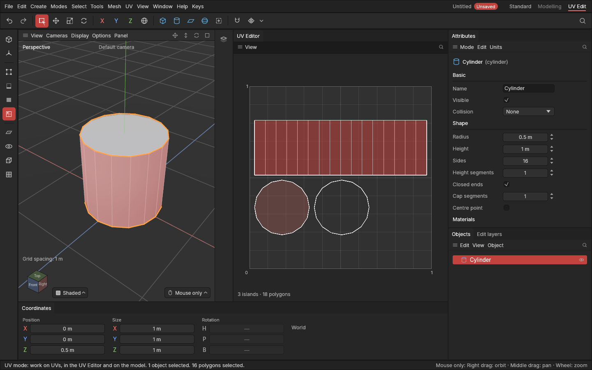

# The UV Editor and the UV mode

> The UV Editor shows the selected objects' UVs laid flat on the texture square, and lets you select points, edges, polygons or whole pieces there, the same selection as in the viewport, and move, turn and scale them.

A shape's [UVs](concepts.md#uvs-and-texturing) say where each part of its surface sits on a texture. The **UV Editor** shows them flat: the square is the texture, and every polygon is drawn where it sits on it. Seeing the two side by side, the 3D shape and its flat UVs, is how you check that a texture will land where it should. Every shape in this app comes with [ready-made UVs](primitives.md#ready-made-uvs), so there's something to see straight away.

## When to use it

- To see how a shape is laid out on its texture: where its seams are, how big each piece is.
- To find a part of the model on the texture, or a part of the texture on the model: select it in one, see it in the other.
- To move, turn, scale and flip pieces by hand: see [Editing UVs by hand](editing-uvs.md). To lay them flat: [Unwrap](unwrapping.md). To arrange them: [Pack](packing.md).

## How to use it

1. Click **UV Edit** on the right of the menu bar. The viewport and the UV Editor sit side by side, and the app switches to the **UV mode**. (The modifiers palette is hidden in the UV mode, as nothing on it works on UVs; in another mode it comes back on the UV Editor's right, beside the Attributes panel.) (Click **Standard** to go back; each layout keeps its own arrangement.) Or keep your layout and choose **Window → UV Editor** to show the editor beside the viewport.
2. Select an object. Its UVs appear on the square:
   - every polygon's outline in grey;
   - the borders of each **piece** (a part laid flat in one go; other programs say *island*) brighter;
   - [seams](seams.md) in orange;
   - with the viewport's **Display → Stretch**, each polygon coloured by how evenly it lies, and pointing at one explains its problem ([Checker and Stretch views](checker-and-stretch.md));
   - with the viewport's **Display → Numbered checker**, the same labelled cells behind the UVs as on the model;
   - the selection in the accent colour, drawn thicker than seams and borders and on top of them, and what's under the mouse lit up. (**High contrast** in Settings makes it larger still, with a dark rim.) What's under the mouse on the model lights up here too, and the other way round.
3. Select:
   - In the **UV mode**, click a piece (in the editor or on the model) to select all of it. **Ctrl + click** adds or takes away another.
   - In the **Points**, **Edges** or **Polygons** mode (keys **1**, **2**, **3**), click or drag a box in the editor to select those, just like in the viewport.

   Both show the same selection: what you pick in one lights up in the other.
4. Move around the editor with your usual [navigation controls](navigating-the-view.md):
   - the drags that pan or orbit the viewport both pan here (a flat view has nothing to orbit);
   - the drags that zoom it zoom here;
   - the wheel zooms at the mouse.

   With the mouse over the editor, **H** fits the texture square and **Z** fits the selection.
5. To change what you've selected, press **W**, **R**, **S** or **T** for the gizmo, or **E** over the editor for the UV tools. See [Editing UVs by hand](editing-uvs.md), or drag on the model itself: [Editing UVs on the model](uvs-on-the-model.md).

The bottom right shows the project's texture size and the [texel density](texture-and-density.md) of what's selected; the **Texture** menu changes them. Zoomed right in, the texture's pixels show as a fine grid.

**The editor's menu line** starts with a **UV** button: it holds the whole UV menu, the same as **UV** on the main menu bar (seams, turn and flip, lay out, pieces, texture, trim sheet, Check for baking and the settings), so every UV command is right above the square. Then come **Texture**, **Trim**, **Snapshots** and **View**.

In the **UV Edit** layout, a **UV settings** panel sits as a tab beside Attributes: every setting of the automatic UV tools, in sections you can fold open, the same as **UV → Settings** ([Settings of the automatic UV tools](uv-settings.md)).

In the UV mode the viewport shows the **seams** in orange, where the surface is cut open to lie flat. **Display → Show seams** shows them while editing points, edges or polygons too.

## Settings

| Setting | What it does |
|---|---|
| **UV** (the editor's menu) | The whole UV menu, as on the main menu bar. |
| **Texture** (the editor's menu) | The texture size and texel density aimed for, saved with the project. See [Texture size and texel density](texture-and-density.md). |
| **Trim** (the editor's menu) | The rows of the project's trim sheet. See [Trim sheets](trim-sheets.md). |
| **View → Explain choices** (the editor's menu) | Point at a seam or a piece to see why it's there and how to change it. See [Why is this here?](why-is-this-here.md). |
| **View → Numbers on pieces**, **View → Measure** (the editor's menu) | Each piece's size, texel density and stretch written on it; measuring lines in pixels and centimetres. Overlapping and mirrored pieces are always tinted red and purple. See [Seeing and checking UVs](seeing-and-checking.md). |
| **Snapshots** (the editor's menu) | Named versions of the UV layout, to put back or compare with. See [Layout snapshots](layout-snapshots.md). |
| **UV Edit** (menu bar) | The layout for UV work: viewport and UV Editor side by side, in the UV mode, with the UV settings panel beside Attributes. |
| **Window → UV Editor** | Shows the editor beside the viewport in the layout you're in, or puts it away. |
| **Display → Show seams** (viewport) | Marks seams in orange while editing points, edges or polygons. Always on in the UV mode. Off as standard. |

## Shortcuts

| Action | Shortcut |
|---|---|
| Fit the texture square | **H** (mouse over the editor) |
| Fit the selection's UVs | **Z** (mouse over the editor) |
| Points, Edges, Polygons modes | **1**, **2**, **3** |
| Select / add or take away | Click / **Ctrl + click** (your selection keys) |
| Box select | Drag |
| Move, rotate, scale UVs | **W**, **R**, **S**, **T** ([Editing UVs by hand](editing-uvs.md)) |
| UV tools | **E** (mouse over the editor) |
| Select whole pieces (from a little of each) | **Alt + A** (mouse over the editor) |
| Pan, zoom | Your viewport navigation controls; the wheel zooms |

The keys are the same as in the viewport: they work wherever the mouse is.

## Tips and common problems

- **Problem:** the editor says "Select an object to see its UVs". **Why:** it shows only the selected objects. **Fix:** select one, in the viewport or the Objects panel.
- **Problem:** the new walls of an extrude don't show in the editor. **Why:** they're there, but squashed flat along the old border: an extrude stretches the UVs it finds. **Fix:** select them and choose [Unwrap](unwrapping.md) (E over the editor).
- **Problem:** clicking in the editor does nothing in the Model mode. **Why:** the Model mode works on whole objects. **Fix:** switch to the UV mode, or press 1, 2 or 3.
- **Problem:** two pieces lie on top of each other and a click or box takes bits of both. **Why:** the click picks what's under the mouse, and both are. **Fix:** select a little of the piece you want (a polygon you can see is safest), press **Alt + A** with the mouse over the editor to get the whole piece, then move it away (W).
- **Tip:** a shape with more than 300,000 polygons doesn't draw its UVs, so the window stays quick. The editor says so.

## Related

- [Primitives: ready-made UVs](primitives.md#ready-made-uvs)
- [Editing UVs by hand](editing-uvs.md)
- [Seams](seams.md)
- [Selecting](selecting.md)
- [Settings of the automatic UV tools](uv-settings.md)
- [Concepts: UV map, seam, piece, corner](concepts.md#uvs-and-texturing)
