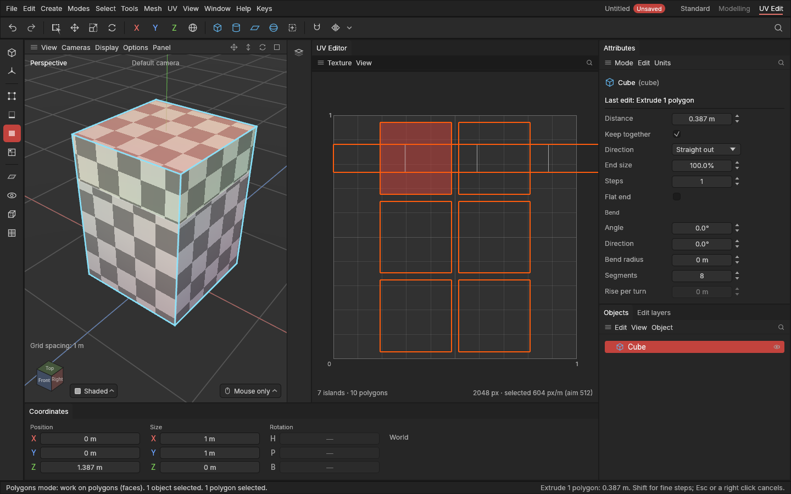

# UVs while you keep modelling

> Keep modelling after you've done the UVs: new polygons get UVs that fit straight away, and your UV work stays.

## When to use it

You don't have to do anything: it happens by itself. It matters whenever you change a shape after working on its [UVs](concepts.md#uvs-and-texturing). In many programs, a late extrude or bevel leaves squashed or stretched UVs that you have to fix by hand, so you're told to finish modelling before you unwrap. Here you can work in any order:

- **Edits after UV work.** Extrude, inset, bevel, loop cut, bridge, fill holes and the other modelling tools give the polygons they make UVs that fit straight away.
- **Edits before UV work.** Change an edit made earlier (in the [edit list](edit-list.md)), or a shape's settings such as a cube's segments. Your seams, unwraps, turns, moves and packing are made again on the new shape, as all edits are.

## How it works

After each edit that adds or changes polygons, the app looks at the polygons the edit made or changed. Most come out fine: a loop cut, for example, shares out the UVs of the polygons it cuts. The ones that come out **broken** are laid out again:

- squashed flat, with no room on the texture (an extrude's walls start like this);
- mirrored against the polygons around them;
- stretched far more one way than the other;
- far bigger or smaller than the polygons around them.

How they are laid out:

- **Next to kept polygons, they carry on from them.** The polygons around keep their UVs exactly. The new ones are fitted to them, as if the piece had always been that shape. A piece you turned, moved or scaled by hand stays as you left it.
- **Where pieces meet**, the new polygons join the piece they share the longest border with. A [seam](seams.md) separates them from the others. Bevelling an edge that is a seam keeps the seam, on one side of the bevel.
- **Polygons with nothing to carry on from** (the walls of an extrude, which the extrude separates with seams) become a **new piece**. It is laid out as [Unwrap](unwrapping.md) would: a strip of square polygons comes out straight, at the same [texel density](texture-and-density.md) as the rest, inside the texture square.

Moving points doesn't change UVs. The texture stretches with the shape, as in other programs. The [Stretch view](checker-and-stretch.md) shows where, and Relax or Unwrap fixes it.

It's part of each edit: **Ctrl + Z** takes back the edit and its UVs together. Change the edit afterwards (an extrude's distance, say) and the UVs follow.

## Settings

In **UV → Mending**, saved with the project (so everyone opening it sees the same UVs):

| Setting | What it does |
|---|---|
| **Mend UVs after each edit** | On (standard): each modelling edit lays out again the UVs it broke. Off: edits leave UVs as they come out, for you to [Unwrap](unwrapping.md) when you're ready. |
| **Mend when stretched** | A polygon an edit changed counts as broken when it's stretched this many times more one way than the other: 3× standard (1.5× to 20×). Lower mends more. |
| **Mend when sized off** | A polygon an edit changed counts as broken when its texture is this many times bigger or smaller than its neighbours': 3× standard. Lower mends more. |

Changing these is one undo step, and every shape in the project is worked out again with them. Only polygons an edit made or changed are touched, so nothing you did on purpose elsewhere changes. (Past 20,000 broken polygons in one edit, they're left for you to [Unwrap](unwrapping.md), so the edit isn't held up.)

## Shortcuts

None of its own: it comes with every modelling tool.

## Tips and common problems

- **Problem:** after an extrude, a new strip overlaps other pieces in the UV Editor. **Why:** new pieces are placed where the polygons they came from were; nothing is moved out of the way. **Fix:** [Pack](packing.md).
- **Problem:** a new strip sticks out of the texture square. **Why:** it's longer than the square at your texel density (a long wall all round a shape). **Fix:** add a seam across it, or Pack (which scales everything to fit).
- **Problem:** I moved points and the texture looks stretched. **Why:** moving points never changes UVs. **Fix:** select the piece and **Relax**, or **Unwrap** it.
- **Tip:** with **Display → Checker** on, you can watch the new polygons get even squares as you drag an extrude or bevel.

## Related

- [Unwrap, Relax and Straighten](unwrapping.md)
- [Seams](seams.md)
- [Checker and Stretch views](checker-and-stretch.md)
- [The edit list](edit-list.md)
- [Concepts: UV map, island, seam](concepts.md#uvs-and-texturing)
