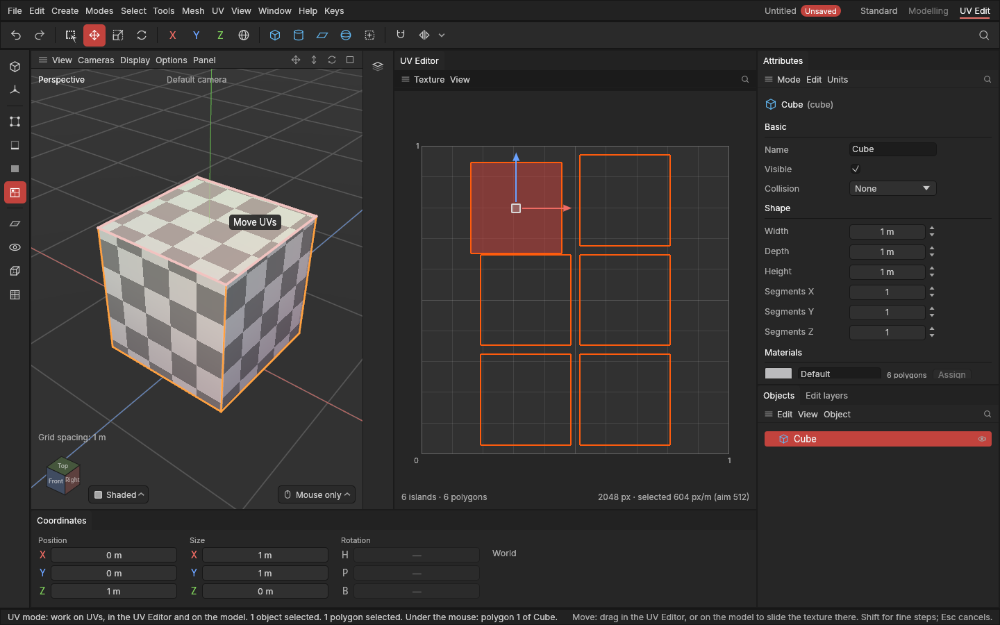

# Editing UVs on the model

> Slide, turn and scale a piece's texture by dragging right on the shape in the viewport, and see which piece is which in both views.

## When to use it

Many small UV fixes are easier to judge on the model than on the flat texture square, because that's where the texture will be seen:

- slide a texture so a line or a square's edge falls exactly on a panel's edge;
- turn a piece so stripes or wood grain run along it;
- make a piece's texture a little bigger or smaller to match its neighbours.

You change the same [UVs](concepts.md#uvs-and-texturing) as in the [UV Editor](editing-uvs.md), just from the other side: you move the texture as you see it on the shape, and the UVs follow.

## How to use it

1. Turn on **Display → Checker** in the viewport so you can see the texture move ([Checker and Stretch views](checker-and-stretch.md)).
2. Switch to the **UV mode** (click **UV Edit** on the right of the menu bar, or choose the UV mode on the left).
3. Press **W** (move), **R** (rotate), **S** (scale) or **T** (all three, which moves).
4. Drag anywhere in the viewport, starting on the piece you want. If that piece isn't selected, the press selects it first. All the selected pieces change together:
   - **W:** the texture slides with the mouse, across the surface you're looking at.
   - **R:** drag right or left to turn the texture about the middle of the pieces.
   - **S:** drag right to make the texture bigger on the shape, left to make it smaller.

   You see it change while you drag, on the model and in the UV Editor. Each drag is **one undo step** (**Ctrl + Z**).

**Why the UVs move the other way.** Sliding a texture right on the shape means its UVs move left on the texture square, and making the texture look bigger means the UVs shrink. The app does that for you, so you only think about what you see on the model.

**Which piece is which.** With the mouse over a piece on the model, it lights up in the UV Editor; with the mouse over a polygon in the UV Editor, it lights up on the model. So you can find a piece in either view straight away.

## Settings

The drags use the viewport's snapping settings, as the gizmo does:

| Setting | What it does on the model |
|---|---|
| **Snapping** (on, or hold **Ctrl** to flip it) | **R** turns in steps of **Turns snap every** (15° as standard), **S** scales in steps of **Scaling every** (10%). Moves don't snap. |

## Shortcuts

| Action | Shortcut |
|---|---|
| Move, Rotate, Scale the texture | In the UV mode: **W**, **R**, **S** (or **T**), then drag in the viewport |
| Finer drag (ten times slower) | Hold **Shift** while dragging |
| Snap, or not when snapping is on | Hold **Ctrl** while dragging |
| Cancel a drag | **Esc** or a right click |
| Undo | **Ctrl + Z** |

These are the same keys as everywhere else; the drag on the model is new. They were chosen without asking you first (you were away); say if you'd like them different.

## Tips and common problems

- **Problem:** the texture doesn't quite follow the mouse. **Why:** with pieces on several sides selected (all of a cube, say), the app works out one average direction for all of them, which fits the side facing you best. **Fix:** select just the piece you're looking at.
- **Problem:** a drag says "Select the islands to move first". **Why:** nothing was selected and the press wasn't on a piece. **Fix:** start the drag on the piece, or click it first.
- **Problem:** the shape itself doesn't move with W. **Why:** that's intended: in the UV mode W, R and S work on UVs, so they never move the shape by accident. **Fix:** press **3** (Polygons) or go back to the Model mode to move the shape.
- **Tip:** to line up a texture with an edge, hold **Shift** for the last bit of the drag.

## Related

- [Editing UVs by hand](editing-uvs.md): the same changes in the UV Editor, with a gizmo
- [Checker and Stretch views](checker-and-stretch.md)
- [The UV Editor and the UV mode](uv-editor.md)
- [Concepts: UV map, island](concepts.md#uvs-and-texturing)
