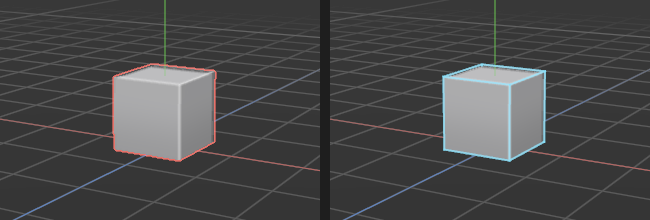

# How shapes are drawn

> Choose how the viewport draws your shapes: solid or only the edges, seen through; whether the edges show on solid shapes; and whether ridges and creases are picked out (Cavity).

The same model can be easier to read in different ways. Solid shading shows its form, the way it will look in a game. Seeing the edges shows how it is built: where the polygons are, whether the loops run where you want, and where a shape is too dense or too sparse. A wireframe shows every edge at once, front and back, so you can see inside and behind a shape without orbiting round it.

## When to use it

- **Shaded** (the standard): most of the time. Calm, solid surfaces, with no lines over them, so you see the form as a game will show it.
- **Shaded with Edges ticked**: while modelling, to see the [topology](concepts.md#mesh-basics) (how the polygons are laid out) on top of the form. Handy for checking loops before a [loop cut](loop-cut.md) or a [bevel](bevel.md). The Points, Edges and Polygons modes tick it for you.
- **Wireframe**: to see edges hidden behind the shape, line up parts that sit inside each other, or check a shape's density at a glance.

## How to use it

1. Click the button in the **bottom-left corner of the viewport**, beside the X/Y/Z axes. It shows the look in use (*Shaded* to start with).
2. Pick **Shaded** or **Wireframe**.
3. Tick **Edges**, under them, to draw every edge over the solid surfaces in light grey; untick it for clean surfaces. (In Wireframe it's greyed out: the edges are all there is.)

The same choices are at the top of the viewport's **Display** menu. They apply to every view (all four, when four are showing) and are remembered next time.

### Edges tick themselves while you edit

Working on points, edges or polygons, you need to see the edges, so entering the **Points**, **Edges** or **Polygons** mode ticks **Edges** for you. Going back to the **Model** mode unticks it again, so the shape is clean once more. If you change the switch yourself while in one of those modes, or it was already on before, the app leaves it as you set it.

**Why it works this way:** most of the time edges are only clutter over a shape's form; they matter when you're picking parts of it. Letting the modes switch them saves you doing it each time, and the switch is still there when you want edges while working on whole objects.

**How the selection shows:** with Edges off, a selected object gets a thin outline in the accent colour round it on screen. Only the part you can see is outlined, so an object in front cuts the outline. With Edges on (and in Wireframe), the selected objects' edges are drawn in the accent colour as well, so the selection always shows. In the Points, Edges and Polygons modes the object you're editing isn't outlined: its points, edges and polygons show instead. The selection is drawn thickest and brightest, on top of everything else; for it to stand out even more, switch on **High contrast** in **Edit → Settings… → Interface** (larger, with a dark rim; see [Settings](settings.md)). In the Points, Edges and Polygons modes, points, selected elements and hard edges are drawn over the shape as usual.

In **Wireframe**, clicking still picks the shape you click inside, as if it were solid: you don't have to hit an edge exactly. A very dense shape seen from far away keeps a faint outline instead of fading away completely, so it never vanishes.

## Checker and Stretch

Under **Surface** in the **Display** menu, **Checker**, **Numbered checker** and **Stretch** show how your UVs lie on the shapes instead of their colours. See [Checker and Stretch views](checker-and-stretch.md). **Painted** shows each material's painted texture: see [Painting textures](painting-textures.md).

## Cavity

**Cavity** brightens ridges and darkens creases on the surfaces: a thin light line where a shape turns outward (a box's outer corner, the rim of a raised panel) and a soft shadow where it turns inward (the inside corner of a recess, a groove). It's like light catching the edges and dust settling in the cracks. It makes a shape's form easy to read at a glance, especially flat hard-surface parts in a single grey. It changes only how the shape looks, never the shape.

It's **on as standard**. Switch it with **Display → Cavity**, in the viewport's menu line, where it sits with **Show hard edges**, **Show seams**, **Show normals**, **Show collision** and **Show triangles**: the things drawn over the surfaces. **Show seams** marks, in orange, where the surface is cut open for its UVs, while editing points, edges or polygons; the UV mode always shows them ([The UV Editor](uv-editor.md)). **Show collision** outlines, in yellow, every object's collision shape, not only the selected objects' ([Collision shapes](collision-shapes.md)). **Show triangles** draws faint lines inside every shape's polygons where the export cuts them into triangles for a game engine ([Triangles](triangulate.md)). Remembered.

Cavity works in **Shaded**, with or without Edges. **Wireframe** has no surfaces to pick out. It's worked out from the picture on screen, so it looks the same at any distance: zoomed out, a whole crate's details read clearly; zoomed in, the lines stay thin.

## Settings

| Setting | What it does |
|---|---|
| **Surface** (**Display** menu) | **Colours** (standard), **Painted** (see [Painting textures](painting-textures.md)), **Vertex colours** (see [Vertex colours](painting-textures.md#vertex-colours)), **Checker**, **Numbered checker** or **Stretch**: see [Checker and Stretch views](checker-and-stretch.md). Remembered. |
| **Show collision** (**Display** menu) | Off (the standard): only the selected objects' [collision shapes](collision-shapes.md) are outlined. On: every object's. Remembered. |
| **Show triangles** (**Display** menu) | Off (the standard). On: faint lines inside every shown shape's polygons, where the export cuts them into triangles. See [Triangles](triangulate.md). Remembered. |
| **Paint preview** (the bottom-left button, or **Display** menu, while the surface is Painted) | **Lit**, **Unlit**, **Toon**, **Godot**, **Godot toon**, **Value check** or **Squint**: see [Previewing your painting](painting-textures.md#previewing-your-painting). Remembered. |
| **See it as the player will** (the bottom-left button, or **Display** menu) | Off (the standard). On: each view shows the model as small as on a player's screen, its pixels enlarged; see [Seeing it as the player will](painting-textures.md#seeing-it-as-the-player-will). Remembered. |
| **Cavity** (**Display** menu) | On (the standard): ridges brightened and creases darkened. Off: plain shading. Remembered. |
| **Shading** (the bottom-left button, or **Display** menu) | **Shaded**: solid, softly lit surfaces. **Wireframe**: only the edges, seen through the shape. Remembered. |
| **Edges** (the bottom-left button, or **Display** menu) | Off (the standard): no lines over the surfaces; the selection is outlined. On: every edge drawn clearly in light grey over the surfaces. Ticked by the Points, Edges and Polygons modes while you use them. Remembered as you set it yourself. |

## Shortcuts

| Action | Shortcut |
|---|---|
| Choose the look, or tick Edges | Click the button in the viewport's bottom-left corner, or **Display** in the viewport's menu line |
| Cavity on or off | **Display → Cavity** |

There is no key for it yet, so no key is taken from future tools. Ask if you'd like one.

## Tips and common problems

- **Tip:** Cavity shows up small mistakes: a stray edge, a polygon slightly out of line, or a crease where you expected a flat surface all catch a line.
- **Problem:** Cavity draws lines across a smooth curve. **Why:** the curve is made of few polygons, so it really does turn at each edge. **Fix:** give the shape more sides, or switch Cavity off for that look.

- **Tip:** in a busy scene, Wireframe can get crowded. Hide what you aren't working on first ([Hide and isolate](hide-and-isolate.md)).
- **Tip:** the Wireframe look only draws edges on screen; it doesn't change the shape or what exports. To make real bars from a shape's edges, for a frame or a cage, use the [Struts](struts.md) modifier.
- **Problem:** I can't see the edges in the Model mode any more. **Why:** Edges is off as standard, so shapes look clean. **Fix:** tick **Edges** in the bottom-left button's list.
- **Problem:** the outline round a selected object shows only part of it. **Why:** the outline follows what you can see; something in front hides the rest. Orbit round, or tick **Edges** to see its edges in the accent colour.
- **Problem:** the corner axes moved. **Why:** they now sit in the bottom-left corner, beside the look button, with the grid spacing just above. The top right is kept clear.
- **Problem:** in Wireframe, a box drag selects things behind other things. **Why:** with selecting through on (the standard), the box catches everything inside its outline, front and back; that's the same in every look. See [Selecting](selecting.md).

## Related

- [Navigating the view](navigating-the-view.md): orbit, pan and zoom, and the grid.
- [Hard and soft edges, and normals](hard-and-soft-edges.md): the Display menu's other switches.
- [Concepts](concepts.md): [topology](concepts.md#mesh-basics), [edge loops](concepts.md#mesh-basics).
