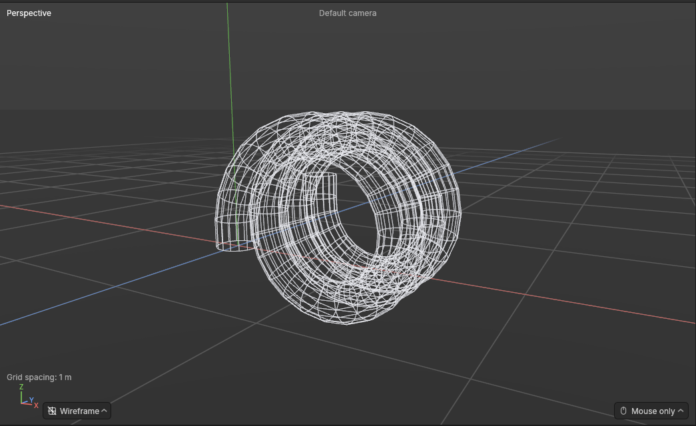
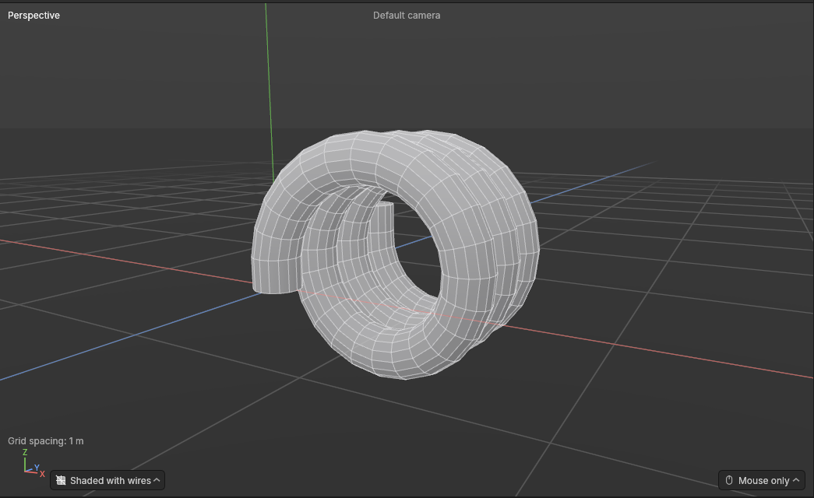
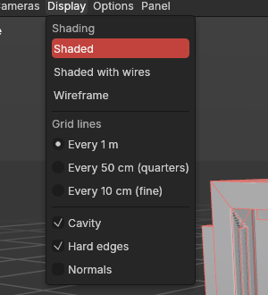
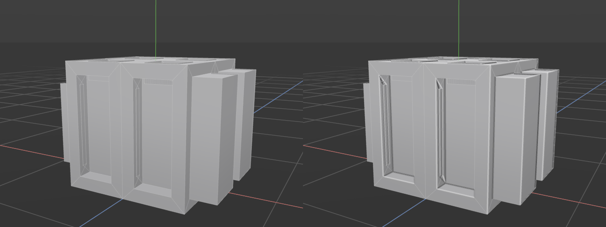

# How shapes are drawn

> Choose how the viewport draws your shapes: solid, solid with every edge showing, or only the edges, seen through; and whether ridges and creases are picked out (Cavity).

The same model can be easier to read in different ways. Solid shading shows its form, the way it will look in a game. Seeing the edges shows how it is built: where the polygons are, whether the loops run where you want, and where a shape is too dense or too sparse. A wireframe shows every edge at once, front and back, so you can see inside and behind a shape without orbiting round it.

## When to use it

- **Shaded** (the standard): most of the time. Calm, solid surfaces with faint edges.
- **Shaded with wires**: while modelling, to see the [topology](concepts.md#mesh-basics) (how the polygons are laid out) on top of the form. Handy for checking loops before a [loop cut](loop-cut.md) or a [bevel](bevel.md).
- **Wireframe**: to see edges hidden behind the shape, line up parts that sit inside each other, or check a shape's density at a glance.

## How to use it

1. Click the button in the **bottom-left corner of the viewport**, beside the X/Y/Z axes. It shows the look in use (*Shaded* to start with).
2. Pick **Shaded**, **Shaded with wires** or **Wireframe**.

The same three choices are at the top of the viewport's **Display** menu. Your choice applies to every view (all four, when four are showing) and is remembered next time.

Selected objects' edges are drawn in the accent colour in every look, so the selection always shows. In the Points, Edges and Polygons modes, points, selected elements and hard edges are drawn over the shape as usual.

In **Wireframe**, clicking still picks the shape you click inside, as if it were solid: you don't have to hit an edge exactly. A very dense shape seen from far away keeps a faint outline instead of fading away completely, so it never vanishes.

## Checker and Stretch

Under **Surface** in the **Display** menu, **Checker** and **Stretch** show how your UVs lie on the shapes instead of their colours. See [Checker and Stretch views](checker-and-stretch.md).

## Cavity

**Cavity** brightens ridges and darkens creases on the surfaces: a thin light line where a shape turns outward (a box's outer corner, the rim of a raised panel) and a soft shadow where it turns inward (the inside corner of a recess, a groove). It's like light catching the edges and dust settling in the cracks. It makes a shape's form easy to read at a glance, especially flat hard-surface parts in a single grey. It changes only how the shape looks, never the shape.

It's **on as standard**. Switch it with **Display → Cavity**, in the viewport's menu line, where it sits with **Hard edges**, **Seams** and **Normals**: the things drawn over the surfaces. **Seams** marks, in orange, where the surface is cut open for its UVs, while editing points, edges or polygons; the UV mode always shows them ([The UV Editor](uv-editor.md)). Remembered.

Cavity works in **Shaded** and **Shaded with wires**. **Wireframe** has no surfaces to pick out. It's worked out from the picture on screen, so it looks the same at any distance: zoomed out, a whole crate's details read clearly; zoomed in, the lines stay thin.

## Settings

| Setting | What it does |
|---|---|
| **Surface** (**Display** menu) | **Colours** (standard), **Checker** or **Stretch**: see [Checker and Stretch views](checker-and-stretch.md). Remembered. |
| **Cavity** (**Display** menu) | On (the standard): ridges brightened and creases darkened. Off: plain shading. Remembered. |
| **Shading** (the bottom-left button, or **Display** menu) | **Shaded**: solid, softly lit surfaces with faint edges. **Shaded with wires**: solid surfaces with every edge drawn clearly in light grey. **Wireframe**: only the edges, seen through the shape. Remembered. |

## Shortcuts

| Action | Shortcut |
|---|---|
| Choose the look | Click the button in the viewport's bottom-left corner, or **Display** in the viewport's menu line |
| Cavity on or off | **Display → Cavity** |

There is no key for it yet, so no key is taken from future tools. Ask if you'd like one.

## Tips and common problems

- **Tip:** Cavity shows up small mistakes: a stray edge, a polygon slightly out of line, or a crease where you expected a flat surface all catch a line.
- **Problem:** Cavity draws lines across a smooth curve. **Why:** the curve is made of few polygons, so it really does turn at each edge. **Fix:** give the shape more sides, or switch Cavity off for that look.

- **Tip:** in a busy scene, Wireframe can get crowded. Hide what you aren't working on first ([Hide and isolate](hide-and-isolate.md)).
- **Problem:** the corner axes moved. **Why:** they now sit in the bottom-left corner, beside the look button, with the grid spacing just above. The top right is kept clear.
- **Problem:** in Wireframe, a box drag selects things behind other things. **Why:** with selecting through on (the standard), the box catches everything inside its outline, front and back; that's the same in every look. See [Selecting](selecting.md).

## Related

- [Navigating the view](navigating-the-view.md): orbit, pan and zoom, and the grid.
- [Hard and soft edges, and normals](hard-and-soft-edges.md): the Display menu's other switches.
- [Concepts](concepts.md): [topology](concepts.md#mesh-basics), [edge loops](concepts.md#mesh-basics).
